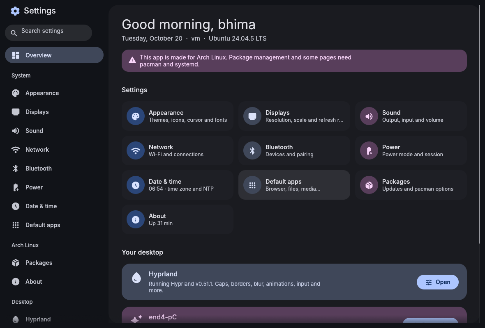
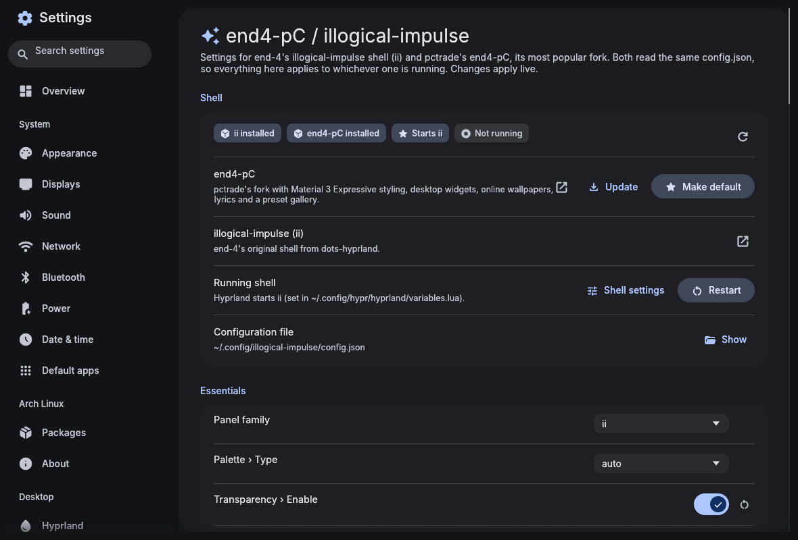
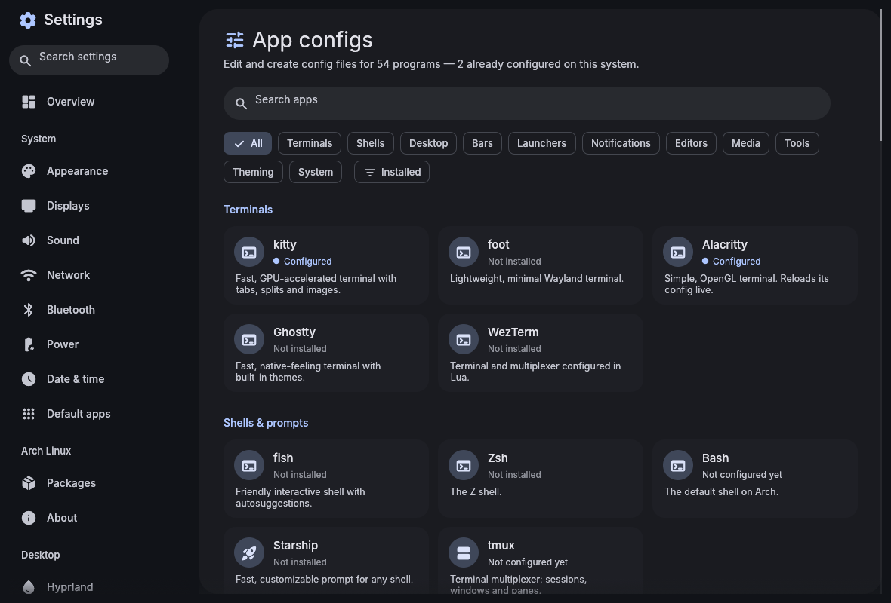
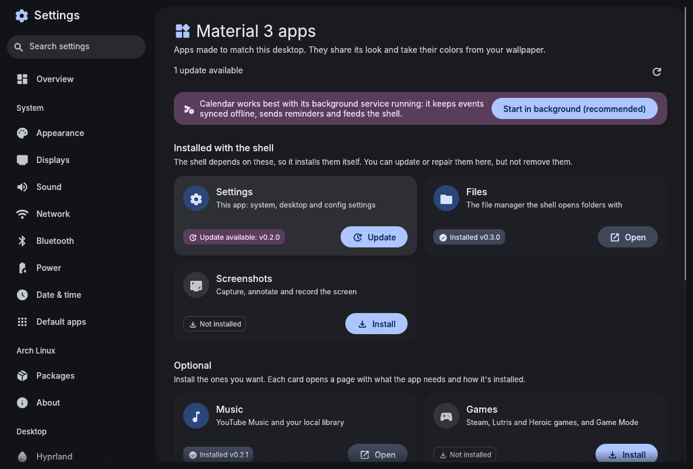
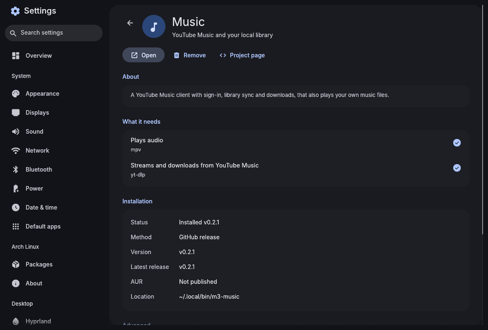
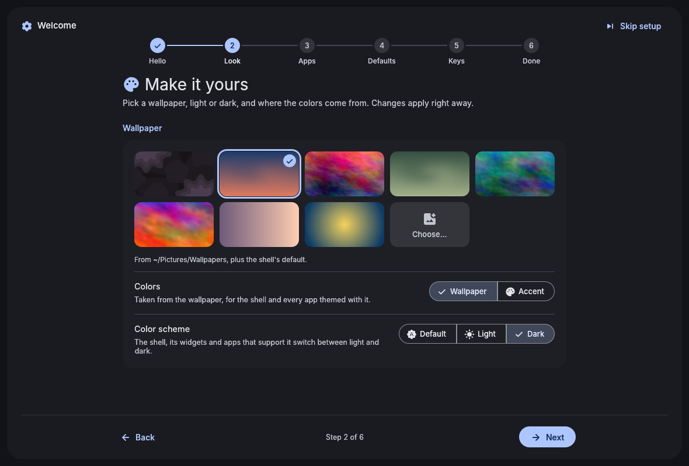

# Material 3 Settings

A settings manager for Arch Linux, built with [egui](https://github.com/emilk/egui) and themed with Material You. It shares its look, widgets and fonts with the other Material 3 apps through [material-3-ui](https://github.com/bhimio1/material-3-ui), and on an end-4 desktop it takes its colors from your wallpaper, like the shell does.





## Features

**System**
- **Appearance:** the wallpaper and where its colors come from (with the end-4 shell), GTK theme, icon theme, cursor theme and size, interface and monospace fonts, light/dark preference. Changes go through `gsettings` and are mirrored into the GTK 3/4 `settings.ini` files. Cursor changes apply to Hyprland straight away.
- **Displays:** resolution, refresh rate, scale, rotation and position for each monitor (Hyprland). Try a change first, then keep it.
- **Sound:** output and input devices, the default device, volume and mute (`pactl`).
- **Network:** Wi-Fi on/off, scan and connect (with a password prompt), saved networks, wired and VPN profiles, airplane mode, hostname (`nmcli`).
- **Bluetooth:** power, visibility, scan, then pair, connect or forget devices, with battery levels (`bluetoothctl`).
- **Power:** power profiles, battery health and charge limit, brightness, suspend/hibernate/restart/shut down.
- **Date & time:** time zone search, NTP, locale.
- **Default apps:** browser, mail, file manager, terminal, editor, image/video/music/PDF viewers and archive manager (`xdg-mime`).

**Arch Linux**
- **Packages:**
  - package counts, pending pacman and AUR updates, and "Update now";
  - removing orphans and cleaning the cache;
  - choosing an AUR helper, or installing paru;
  - `pacman.conf` options (Color, ILoveCandy, ParallelDownloads, multilib, …), saved with one polkit prompt and a `.bak` copy;
  - mirror ranking with reflector;
  - package search with install and remove.
- **About:** hardware and software summary, plus a "Copy system info" button for bug reports.

Anything interactive (installs, upgrades) opens in your terminal so you can see it and type your password.

**end4-pC / illogical-impulse**

[end4-pC](https://github.com/pctrade/end4-pC) is pctrade's fork of end-4's [illogical-impulse](https://github.com/end-4/dots-hyprland), and the most popular one. Both read `~/.config/illogical-impulse/config.json`, so this page works for either.
- Detects which shells are installed, which one Hyprland starts, and whether it's running.
- Installs or updates end4-pC (pctrade's, with the Material 3 integration added; see below), and makes either shell the default. The default is written to `~/.config/hypr/custom/variables.lua`, so dotfile updates don't undo it.
- Restarts the shell and opens its settings overlay.
- If `~/.config/quickshell/end4-pC` is a checkout of the retired [bhimio1/end4-pC](https://github.com/bhimio1/end4-pC) fork, offers **Switch to pctrade's end4-pC**: the old folder is moved to `end4-pC.fork-backup-<time>`, pctrade's is cloned in its place, the integration and the fork's keybinds are added, and the shell restarts. Your settings are in `~/.config/illogical-impulse`, so they carry over.
- Covers all 588 options with proper controls: switches, sliders, and dropdowns built from the option comments. It has an Essentials card, section chips, search, and reset to default. Changes apply live and leave the rest of the file untouched.

**Shell integration**

The Material 3 changes used to live in a fork of end4-pC. The **Shell integration** page (Desktop → Shell integration, or `m3-settings inject`) adds them to the shell you already use instead, which keeps updating from its own developers:

| Shell | How it's added |
|---|---|
| [illogical-impulse](https://github.com/end-4/dots-hyprland) (ii) and [end4-pC](https://github.com/pctrade/end4-pC) | An `m3/` folder in the shell, plus a few lines between `// m3:begin` / `// m3:end` markers in its files |
| [iNiR](https://github.com/snowarch/iNiR) | The same; `inir update` replaces them and they're put back within seconds |
| [Dux Shell](https://github.com/AvengeMedia/DankMaterialShell) (formerly DankMaterialShell) | A plugin in `~/.config/dms/plugins/Material3`, turned on in `plugin_settings.json`. The shell itself isn't touched |

- On ii and end4-pC it adds: region captures go to Material 3 Screenshots, the first-run welcome is Settings' own, Game Mode's right-click opens the game library (Material 3 Games, also `qs -c <shell> ipc call games toggle`), the sidebar calendar shows Material 3 Calendar's events, and the Bluetooth and network buttons open Settings. Each needs its app installed and otherwise behaves as before.
- On iNiR it adds Settings' welcome and the game library (Game Mode's right-click, or `inir ipc call games toggle`). Niri takes screenshots itself, and iNiR's calendar has its own sync, so those two are left as they are.
- On Dux Shell, the plugin adds a **Games** dash tab (the Material 3 Games library), a **Game Mode** Control Center tile, and Settings' welcome the first time.
- Every shell also gets the **style bridge**: the shell's resolved look (Material 3 colors, light/dark, fonts, rounding, transparency) is written to `~/.local/state/m3/style.json` whenever it changes, and the Material 3 apps read it through material-3-ui, so they follow the shell's presets and custom themes too.
- Each edit finds one line in the upstream file. If an update changes that line, the feature that needs it is left out and listed on the page, and the rest still goes in. Without the core edit to `shell.qml` nothing is changed.
- A systemd user path unit, `m3-shell-inject.path`, watches each shell's `shell.qml` (and iNiR's `.inir-manifest`) and runs `m3-settings inject reapply` after an update. Settings also re-applies when it starts, and **Update** on the end4-pC / ii page takes the edits out before `git pull` and puts them back after.
- If the shell stops running after a change, the files are put back as they were. **Remove** leaves the shell's files byte for byte as upstream ships them.
- What was added is recorded in `~/.local/state/m3-settings/inject/<shell>.json`.

From a terminal: `m3-settings inject status`, `inject apply [ii|end4-pC|inir|dux]`, `inject remove [SHELL]`, `inject reapply`, and `inject migrate` (the fork switch below, without the window).

On Hyprland the page also offers the **keyboard shortcuts** the fork's installer used to add (`m3-settings keybinds add`): Super+I Settings, Super+E Files, Print / Super+Print / Super+Shift+R Screenshots, and Super+G / Super+Shift+G for the game library and Game Mode when the ii/end4-pC integration has it. Keys you've bound already are left alone. They go between `>>> m3-keybinds >>>` markers in `~/.config/hypr/custom/keybinds.lua` (or `.conf`) on end-4's dots, else the main config.

**Login & boot**

The login screen and boot animation that came with the fork (Desktop → Login & boot, or `m3-settings login`). Both use the style bridge's `style.json`, so they match any of the shells above.
- **Login screen:** an SDDM theme (`end4-material`) like the lock screen. **Install** asks for your password once (pkexec or sudo), selects it with `/etc/sddm.conf.d/zz-end4-material.conf`, and **Remove** brings the previous theme back. SDDM can't read your home, so your wallpaper, colors, fonts and avatar are copied to `/var/lib/end4-material-sddm`; the `m3-login-sync.path` user unit does that again whenever `style.json` changes.
- **Boot animation:** a Plymouth theme (`end4-pc`) rendered in your colors. **Refresh colors** renders it again and rebuilds the initramfs. It tells you if the `plymouth` mkinitcpio hook or `splash` on the kernel command line is missing.
- The themes and scripts are in [`login/`](login/README.md), installed to `/usr/share/m3-settings/login`.

**Material 3 apps**

The **Material 3 apps** page (Desktop → Material 3 apps, or `m3-settings material-apps`) is where you install, update, open and remove the apps that go with this desktop:

| App | Command | What it is |
| --- | --- | --- |
| Settings | `m3-settings` | this app |
| Files | `m3fm` | the [file manager](https://github.com/bhimio1/material-3-file-manager-rust) |
| Screenshots | `m3-screenshots` | capture, annotate and record the screen |
| Music | `m3-music` | YouTube Music and your local library |
| Games | `m3-games` | Steam, Lutris and Heroic games, and Game Mode |
| Browser | `m3-browser` | Zen, with websites themed to your wallpaper |
| AI | `m3-ai` | a desktop app for Claude Code |
| Viewer | `m3-viewer` | images and videos |
| Text | `m3-text` | a text editor |
| Monitor | `m3-monitor` | processes and system resources |
| Calendar | `m3-calendar` | Google, Microsoft, iCloud and local calendars |
| Comics | `m3-comics` | a manga and comics reader, like Mihon |

- **Essential apps:** Settings, Files and Screenshots. The shell integration relies on them. Here you can update or repair them, but not remove them.
- **Optional apps:** everything else. You install them from this page.
- **How apps are installed:** automatically by the best method available. You can change the method for each app under *Advanced*:
  1. **AUR package:** `material-3-<app>-bin`, or `-git`, through paru or yay in a terminal. This is used when the package is published. Updates then come with your system updates.
  2. **GitHub release:** the prebuilt binary goes to `~/.local/bin` and the desktop entry to `~/.local/share/applications`. The download is checked against its `.sha256`, and you can watch the progress in the app.
  3. **Build from source:** `git clone`, then `cargo build --release` in a terminal (plus `npm` for the browser extension). This is used when there is no release.
- **Updates:** releases are checked at most every 6 hours and cached in `~/.cache/m3-settings/material-apps`. When GitHub's rate limit is hit, the cached result is used.
- **Shared records:** release and source installs are recorded in `~/.local/state/quickshell/user/material-apps/<command>.version`, the same files the shell's installer writes. So the page also updates apps that the shell installed, and the shell's installer recognises apps installed here.
- **Each app's page:** shows what the app needs (mpv, yt-dlp, gamescope, Suwayomi, …) with an Install button for each. It also has Open, Update, Remove and the project page. Calendar offers to start its background service (`systemctl --user enable --now m3-calendar.service`).
- **Command line:** the shell opens this page with `m3-settings material-apps`, or one app's page with `m3-settings material-apps <app>`. `<app>` can be the command (`m3-music`) or the short name (`music`).




**Welcome**

`m3-settings --welcome` (or `m3-settings welcome`) opens a first-run welcome in place of the sidebar and pages. It walks through six steps with Back and Next, and any step can be skipped:

1. **Hello:** what this desktop is.
2. **Look:** the wallpaper (from `~/Pictures/Wallpapers` and the shell's default, or any file), light or dark, and whether the colors come from the wallpaper or an accent color. These are the Appearance page's controls, and changes apply right away through the shell's `switchwall.sh`. Without the end-4 shell, this step offers light/dark and this app's own colors instead.
3. **Apps:** the optional Material 3 apps, with a checkbox each. "Install selected" installs them like the Material 3 apps page does. AUR packages go to one terminal, source builds to another, and release downloads show their progress in the list.
4. **Defaults:** browser, file manager, terminal, text editor, image viewer and video player, from the Default apps page.
5. **Keys:** the most useful shortcuts. The keys are read from Hyprland (`hyprctl binds`), so rebinds show up, and end-4's defaults are used when Hyprland isn't running.
6. **Done:** Open Settings or Close, and a "Show this at next login" switch, which is off by default.

When it finishes (or the window is closed), it writes `~/.local/state/quickshell/user/first_run.txt`, the marker end4-pC's first-run check looks for, so the shell doesn't greet you a second time. "Show this at next login" deletes the marker instead. Settings also records `welcome_done` in its `config.toml`. `--welcome` always opens the welcome, whatever the marker says, and About → **Run the welcome again** opens it from inside the app.



**Hyprland**
- Gaps, borders, rounding, opacity, blur, shadows, animations, layout, and keyboard, mouse and touchpad input. Current values are read live from `hyprctl`.
- Changes are saved in a marked block in your own config: `custom/general.lua` on end-4 installs, otherwise `hyprland.lua` or `hyprland.conf`. Then `hyprctl reload` runs.
- A searchable list of your keybinds.

**App configs:** 54 programs, including:
- terminals: kitty, foot, Alacritty, Ghostty, WezTerm;
- shells and prompts: fish, zsh, bash, Starship, tmux;
- desktop: hypridle, hyprlock, hyprpaper, sway, i3, niri, picom;
- bars and launchers: Waybar, rofi, fuzzel, wofi, tofi;
- notifications: dunst, mako, swaync;
- editors: Neovim, Helix, micro, VS Code, Zed;
- media and tools: mpv, zathura, MangoHud, btop, fastfetch, yazi, lazygit, git, ssh;
- theming: GTK, qt5ct/qt6ct, Kvantum, fontconfig;
- Arch: paru, yay, makepkg, plus more.

For each one:
- Create the config from a commented template if it doesn't exist.
- **Quick settings:** fonts, sizes, opacity, colors and more, written in each program's own syntax. Comments and the rest of the file are left alone.
- **Editor:** syntax highlighting and line numbers. Saving is refused while a TOML/JSON file has a syntax error, and you're warned if another program changes the file.
- Tell the running app to reload, open its docs, or install it if it's missing.
- Add any other file under "Your files".

**Safety**
- Every save keeps a timestamped backup in `~/.local/state/m3-settings/backups`, which you can restore from the editor.
- Symlinked dotfiles (stow, chezmoi) are written through the link, so the link stays.
- Root-owned files are written through `pkexec`.

## CachyOS

CachyOS is Arch-based, so everything above works there. These parts adapt to it:

- **Installing packages:** each package comes from your configured repos when they have it (CachyOS's own repos carry many packages that are AUR-only on Arch), and from paru or yay otherwise.
- **Packages page:** a CachyOS card shows the optimised repos you use and the running kernel. It opens the CachyOS Kernel Manager and CachyOS Hello, and installs `cachyos-gaming-meta`. "Rank mirrors" uses `cachyos-rate-mirrors`, which ranks the Arch and CachyOS mirrorlists together.
- **Power page:** a **CPU scheduler** card switches sched-ext schedulers and modes through `scxctl` (scx_loader), for example scx_lavd in Gaming mode. It also stops them, or restores the default. It appears wherever `scxctl` is installed.
- **Sidebar:** the "Arch Linux" heading reads "CachyOS".

## Install

From the AUR, prebuilt or built from source:

```sh
paru -S material-3-settings-bin   # or material-3-settings-git
```

From this repository, with the included PKGBUILD:

```sh
cd packaging
makepkg -si
```

Prebuilt x86_64 binaries are attached to [releases](https://github.com/bhimio1/material-3-settings/releases).

Or build directly:

```sh
cargo build --release
./target/release/m3-settings [PAGE]
```

`PAGE` opens a page directly. It can be a page name (`overview`, `sound`, `network`, `packages`, `hyprland`, `end4`, `apps`, …), an app id (`kitty`, `waybar`, …), or `material-apps [APP]` for the Material 3 apps page. `--welcome` opens the first-run welcome instead. You can bind any of these in Hyprland (end-4: `~/.config/hypr/custom/keybinds.lua`):

```lua
hl.bind("SUPER + I", hl.dsp.exec_cmd("m3-settings"))
```

On end-4 you can also make it the settings app the shell opens, in `~/.config/hypr/custom/variables.lua`:

```lua
settingsApp = "m3-settings"
```

Each page offers to install the tool it needs: `glib2`, `libpulse`, `networkmanager`, `bluez-utils`, `power-profiles-daemon`, `brightnessctl`, `pacman-contrib`, `reflector`, `xdg-utils`.

## Theme

In Preferences, **Auto** uses the shell's `~/.local/state/m3/style.json` (see the style bridge above), then the end-4 shell's generated colors (`~/.local/state/quickshell/user/generated/colors.json`). If those don't exist it uses the file manager's matugen `theme.json`, and otherwise a seed color. The theme updates live when the wallpaper changes. Preferences are stored in `~/.config/m3-settings/config.toml`.

## Project layout

```
src/
  app.rs        app state, theme, layout, action dispatch
  catalog.rs    the App configs catalog (paths, formats, templates, quick settings)
  end4.rs       illogical-impulse / end4-pC detection, config.json, option schema
  hypr.rs       hyprctl queries and the managed Hyprland config block
  inject/       shell integration: hooks, apply/remove, the re-apply path unit
  keybinds.rs   the Material 3 apps' suggested Hyprland keybinds
  login.rs      the login screen and boot animation, and their sync unit
  welcome.rs    the welcome's steps, the shell's first-run marker, the keybind cheat sheet
  material_apps/  the Material 3 apps: catalog, release checks, install/update/remove
  files.rs      open config files: save, backups, external changes
  formats/      comment-preserving key/value, TOML and JSONC editing
  sys/          pacman, audio, network, bluetooth, power, GTK, default apps, …
  ui/           sidebar, editor, the welcome, and one module per page
inject/<pack>/            what gets added to each shell (embedded by build.rs);
                          ii is used for ii and end4-pC
login/                    the SDDM and Plymouth themes and their scripts
tests/fixtures/shells/    upstream shell.qml files the injection tests run against
assets/end4/schema.json   generated by scripts/gen_end4_schema.py from end4-pC's Config.qml
```

The palette, egui style, fonts, widgets, page scaffolding, toasts, saving and backups, thumbnails and the command / terminal / Arch helpers come from [material-3-ui](https://github.com/bhimio1/material-3-ui), pinned to a commit in `Cargo.toml`.

Run the tests with `cargo test`. To refresh the end4-pC schema after an upstream update:

```sh
python3 scripts/gen_end4_schema.py ~/.config/quickshell/end4-pC/modules/common/Config.qml > assets/end4/schema.json
```

## License

MIT, see [LICENSE](LICENSE).

Fonts: Inter (SIL OFL 1.1, see `assets/fonts/LICENSE-Inter.txt`). Icons: Material Symbols, via `egui_material_icons` (both bundled through material-3-ui).
