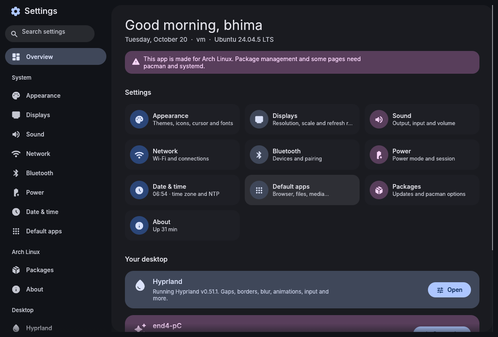
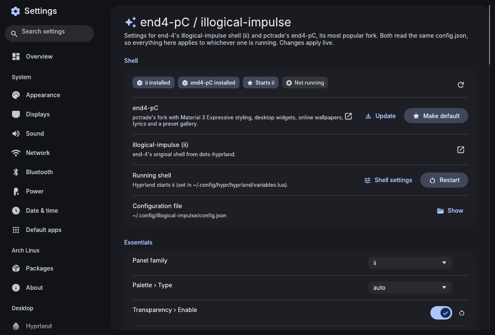
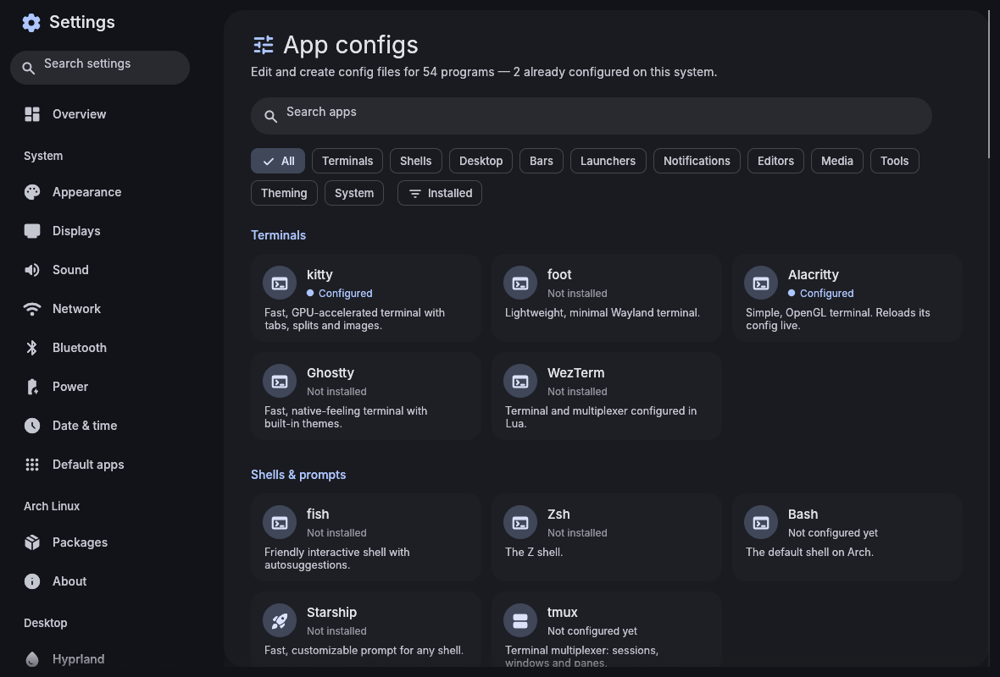

# Material 3 Settings

A settings manager for Arch Linux, built with [egui](https://github.com/emilk/egui) and themed with Material You. It shares its look, widgets and fonts with the [Material 3 File Manager](https://github.com/bhimio1/material-3-file-manager-rust), and on an end-4 desktop it takes its colors from your wallpaper, like the shell does.





## Features

**System**
- **Appearance:** GTK theme, icon theme, cursor theme and size, interface and monospace fonts, light/dark preference. Changes go through `gsettings` and are mirrored into the GTK 3/4 `settings.ini` files. Cursor changes apply to Hyprland straight away.
- **Displays:** resolution, refresh rate, scale, rotation and position for each monitor (Hyprland). Try a change first, then keep it.
- **Sound:** output and input devices, the default device, volume and mute (`pactl`).
- **Network:** Wi-Fi on/off, scan and connect (with a password prompt), saved networks, wired and VPN profiles, airplane mode, hostname (`nmcli`).
- **Bluetooth:** power, visibility, scan, then pair, connect or forget devices, with battery levels (`bluetoothctl`).
- **Power:** power profiles, battery health and charge limit, brightness, suspend/hibernate/restart/shut down.
- **Date & time:** time zone search, NTP, locale.
- **Default apps:** browser, mail, file manager, terminal, editor, image/video/music/PDF viewers and archive manager (`xdg-mime`).

**Arch Linux**
- **Packages:**
  - package counts, pending pacman and AUR updates, and "Update now";
  - removing orphans and cleaning the cache;
  - choosing an AUR helper, or installing paru;
  - `pacman.conf` options (Color, ILoveCandy, ParallelDownloads, multilib, …), saved with one polkit prompt and a `.bak` copy;
  - mirror ranking with reflector;
  - package search with install and remove.
- **About:** hardware and software summary, plus a "Copy system info" button for bug reports.

Anything interactive (installs, upgrades) opens in your terminal so you can see it and type your password.

**end4-pC / illogical-impulse**

[end4-pC](https://github.com/pctrade/end4-pC) is pctrade's fork of end-4's [illogical-impulse](https://github.com/end-4/dots-hyprland), and the most popular one. Both read `~/.config/illogical-impulse/config.json`, so this page works for either.
- Detects which shells are installed, which one Hyprland starts, and whether it's running.
- Installs or updates end4-pC (from [bhimio1/end4-pC](https://github.com/bhimio1/end4-pC), the fork that has these Material 3 apps built in), and makes either shell the default. The default is written to `~/.config/hypr/custom/variables.lua`, so dotfile updates don't undo it.
- Restarts the shell and opens its settings overlay.
- Covers all 588 options with proper controls: switches, sliders, and dropdowns built from the option comments. It has an Essentials card, section chips, search, and reset to default. Changes apply live and leave the rest of the file untouched.

**Hyprland**
- Gaps, borders, rounding, opacity, blur, shadows, animations, layout, and keyboard, mouse and touchpad input. Current values are read live from `hyprctl`.
- Changes are saved in a marked block in your own config: `custom/general.lua` on end-4 installs, otherwise `hyprland.lua` or `hyprland.conf`. Then `hyprctl reload` runs.
- A searchable list of your keybinds.

**App configs:** 54 programs, including:
- terminals: kitty, foot, Alacritty, Ghostty, WezTerm;
- shells and prompts: fish, zsh, bash, Starship, tmux;
- desktop: hypridle, hyprlock, hyprpaper, sway, i3, niri, picom;
- bars and launchers: Waybar, rofi, fuzzel, wofi, tofi;
- notifications: dunst, mako, swaync;
- editors: Neovim, Helix, micro, VS Code, Zed;
- media and tools: mpv, zathura, MangoHud, btop, fastfetch, yazi, lazygit, git, ssh;
- theming: GTK, qt5ct/qt6ct, Kvantum, fontconfig;
- Arch: paru, yay, makepkg, plus more.

For each one:
- Create the config from a commented template if it doesn't exist.
- **Quick settings:** fonts, sizes, opacity, colors and more, written in each program's own syntax. Comments and the rest of the file are left alone.
- **Editor:** syntax highlighting and line numbers. Saving is refused while a TOML/JSON file has a syntax error, and you're warned if another program changes the file.
- Tell the running app to reload, open its docs, or install it if it's missing.
- Add any other file under "Your files".

**Safety**
- Every save keeps a timestamped backup in `~/.local/state/m3-settings/backups`, which you can restore from the editor.
- Symlinked dotfiles (stow, chezmoi) are written through the link, so the link stays.
- Root-owned files are written through `pkexec`.

## Install

From this repository, with the included PKGBUILD:

```sh
cd packaging
makepkg -si
```

Prebuilt x86_64 binaries are attached to [releases](https://github.com/bhimio1/material-3-settings/releases). The end4-pC fork installs the latest one automatically.

Or build directly:

```sh
cargo build --release
./target/release/m3-settings [PAGE]
```

`PAGE` opens a page directly. It can be a page name (`overview`, `sound`, `network`, `packages`, `hyprland`, `end4`, `apps`, …) or an app id (`kitty`, `waybar`, …), so you can bind it in Hyprland (end-4: `~/.config/hypr/custom/keybinds.lua`):

```lua
hl.bind("SUPER + I", hl.dsp.exec_cmd("m3-settings"))
```

On end-4 you can also make it the settings app the shell opens, in `~/.config/hypr/custom/variables.lua`:

```lua
settingsApp = "m3-settings"
```

Each page offers to install the tool it needs: `glib2`, `libpulse`, `networkmanager`, `bluez-utils`, `power-profiles-daemon`, `brightnessctl`, `pacman-contrib`, `reflector`, `xdg-utils`.

## Theme

In Preferences, **Auto** uses the end-4 shell's generated colors (`~/.local/state/quickshell/user/generated/colors.json`). If those don't exist it uses the file manager's matugen `theme.json`, and otherwise a seed color. The theme updates live when the wallpaper changes. Preferences are stored in `~/.config/m3-settings/config.toml`.

## Project layout

```
src/
  app.rs        app state, theme, layout, action dispatch
  catalog.rs    the App configs catalog (paths, formats, templates, quick settings)
  end4.rs       illogical-impulse / end4-pC detection, config.json, option schema
  hypr.rs       hyprctl queries and the managed Hyprland config block
  files.rs      open config files: save, backups, external changes
  formats/      comment-preserving key/value, TOML and JSONC editing
  sys/          commands, background tasks, pacman, audio, network, bluetooth, …
  theme/        M3 palette (seed / matugen) → egui style (shared with the file manager)
  ui/           sidebar, toasts, editor, widgets, and one module per page
assets/end4/schema.json   generated by scripts/gen_end4_schema.py from end4-pC's Config.qml
```

Run the tests with `cargo test`. To refresh the end4-pC schema after an upstream update:

```sh
python3 scripts/gen_end4_schema.py ~/.config/quickshell/end4-pC/modules/common/Config.qml > assets/end4/schema.json
```

Fonts: Inter (SIL OFL 1.1, see `assets/fonts/LICENSE-Inter.txt`). Icons: Material Symbols, via `egui_material_icons`.
